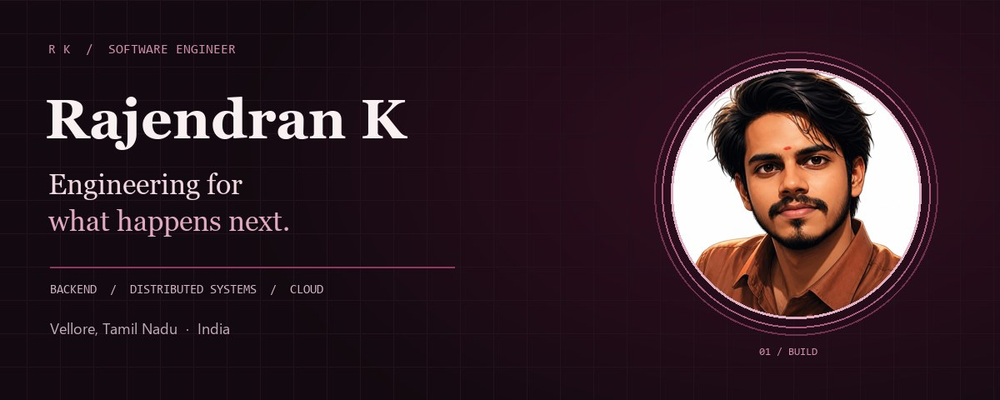
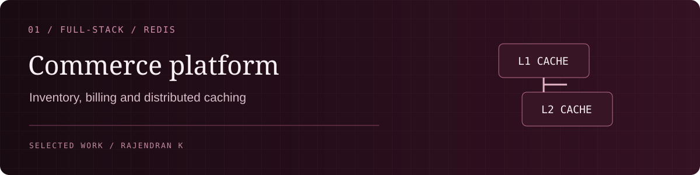
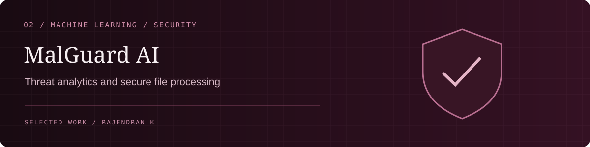

  
  
  

**Most engineers ship code. I care about what happens when that code meets production.**

I'm Rajendran, a software engineer focused on backend systems, distributed computing, cloud infrastructure and performance. My work spans secure applications, benchmarking and observability, with industry experience at Tanla Platforms and projects in AI, IoT and cryptography.

**Java · Spring Boot · Go · AWS · Kubernetes · Distributed Systems**

### Engineering in production

**Software Engineering Intern (SDE) · Tanla Platforms Limited** 
Hyderabad, India · October 2025 – June 2026 · [Experience letter](https://drive.google.com/file/d/1PDVK5kTu5OknAvxnmuB3W_n11pGyInUX/view?usp=sharing)

| The challenge | Evidence and outcome |
| :--- | :--- |
| **Concurrent message dispatch** | **242 average TPS**, 21% above a 200 TPS target; zero message loss during graceful restarts in validated 50K load tests. |
| **Distributed caching** | A Guava and DragonflyDB two-tier cache reduced Guava memory overhead by **approximately 40%**. |
| **Key management** | AWS KMS and automated rotation reduced key management effort by **approximately 60%** and improved secure data retrieval by **approximately 40%**. |
| **Cloud infrastructure** | Validated Karpenter on EKS across **10+ scenarios**; Spot adoption enabled approximately **65% infrastructure cost savings**. |
| **Database decisions** | A RocksDB study spanning **2 million+ records** informed a recommendation against a high-risk migration. |
| **Performance and observability** | Benchmarked a Go HTTP connection pool against JDK 8 and 21 across **30+ configurations**, using Prometheus, Grafana and cAdvisor. Go performed better on memory, CPU and throughput in the tested configurations. |

### Commerce platform · Full-stack systems

A commerce application for inventory, billing and purchase workflows, with role-based access and automated business operations. Its Hyperion component explores two-tier caching, cross-instance invalidation and fault-tolerant database fallback.

`TypeScript` `Next.js` `React` `Tailwind CSS` `REST APIs` `Redis` 
**10+ active users · 15+ billing records** · [Visit the application](https://afino-five.vercel.app)

### MalGuard AI · Applied machine learning

A cloud-deployed malware detection platform combining threat analytics, secure file processing and adversarial sensitivity analysis.

`Python` `Streamlit` `Scikit-learn` `SQL` `AES-GCM` `NetworkX` `PyVis` 
[Explore the application](https://malware-detection-using-ml.streamlit.app)

### More experiments

- **[SoftSecure ID-Generator](https://github.com/K-Rajendran/SoftSecure-ID-Generator)** — Java Swing and MariaDB identity management with AES-256 and QR authentication; reported approximately 30% better ID generation efficiency.
- **IoT Smart Collar** — ESP8266, GPS, LoRa, Flutter and Firebase for tracking and alerts; field trials reported approximately 35% lower cattle-road accident risk.
- **Round-Key Adaptive Cipher** — experimental symmetric cryptography research exploring adaptive key expansion, dynamic S-boxes and round-specific transformations.

| Domain | Technologies |
| :--- | :--- |
| **Languages** | Java · Go · Python · SQL · TypeScript · JavaScript |
| **Backend & distributed systems** | Spring Boot · REST APIs · Hibernate/JPA · RabbitMQ · NATS · Guava · Redis · DragonflyDB |
| **Cloud & infrastructure** | AWS · EKS · KMS · Kubernetes · Docker · Karpenter · Azure |
| **Data & observability** | PostgreSQL · MySQL · MariaDB · MongoDB · RocksDB · Prometheus · Grafana · cAdvisor |
| **Applications & tools** | React · Next.js · Flutter · Firebase · Streamlit · Git |

### Research beyond conventional development

**Published patent application** · Traffic Management System — Intelligent Traffic Flow Optimization Using Automated Detection. Application **202441101026**, filed 19 December 2024 and published 3 January 2025.

**Springer book chapter** · Co-author of [The Influence of Artificial Intelligence in Drug Discovery and Development](https://link.springer.com/chapter/10.1007/978-981-97-2938-8_3), published online 1 February 2025 in *Role of Artificial Intelligence, Telehealth, and Telemedicine in Medical Virology*.

### Recognition

- 🥇 **1st place**, Operation GreenInc Hackathon · March 2024 · [Certificate](https://drive.google.com/file/d/1_F_QyKOrR1gpCwJp4VGTMOREYqhvD_37/view?usp=sharing)
- 🥈 **2nd place**, Reverse Coding Competition · March 2024 · [Certificate](https://drive.google.com/file/d/1_S1TlNPi9f0SQY323TuXNHvss3WcBncq/view?usp=sharing)
- 🥇 **1st place**, Tech Quiz 2K24 · February 2024 · [Certificate](https://drive.google.com/file/d/1SdbwJM5_PWbrevPRc7qreDebJSJVw6yB/view?usp=sharing)
- 🥉 **3rd place**, Coding Conqueror · February 2024 · [Certificate](https://drive.google.com/file/d/1IhEG6nfOGytFK69mhDUDB38Gwin7TodQ/view?usp=sharing)
- 🥉 **3rd place**, Code Auction · October 2022 · [Certificate](https://drive.google.com/file/d/1qAVe4KqQ4rsk9FdU-xpeOnX8Q6HA6J4V/view?usp=sharing)

**Vellore Institute of Technology** · M.Tech in Software Engineering · 2021–2026 · **9.12/10 CGPA**

**Vice Chairman of the Board, Fifth Pillar VIT Student Chapter** · 2023 
Organized a treasure hunt for **350+ participants**, helped conduct the *Law and You* series for **100+ students**, and created **20+ promotional designs**.

Explore my [repositories](https://github.com/K-Rajendran?tab=repositories), [contributions and activity](https://github.com/K-Rajendran), and [GitHub profile](https://github.com/K-Rajendran). GitHub's profile provides the current contribution graph and repository language information directly.

I'm interested in conversations about backend engineering, distributed systems, performance and cloud infrastructure.

  <a href="mailto:rajendran.23.kr@gmail.com">Email</a> &nbsp;·&nbsp;
  <a href="https://www.linkedin.com/in/rajendrankarunanithi">LinkedIn</a> &nbsp;·&nbsp;
  <a href="https://github.com/K-Rajendran">GitHub</a> 
  Vellore, Tamil Nadu, India

<em>Build it. Measure it. Understand what happens next.</em>

